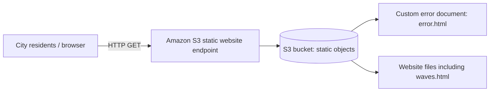

# Lab 01 — Hosting a Static Website with Amazon S3

**Training:** AWS SimuLearn — Cloud Computing Essentials  
**Type:** Guided lab with DIY challenge  
**Status:** Guided configuration completed; DIY validation passed; browser tests not yet recorded  
**Service:** Amazon S3

## 1. Business problem and objective

Mayor Jack's city operates a data center where provisioning infrastructure can take months. Servers supporting the public beach wave-conditions page have experienced repeated failures. Residents use the page to plan beach visits. The city needs faster provisioning and more reliable website hosting without maintaining a dedicated web server for static content.

**Objective:** Configure S3 static website hosting for the existing website files, inspect public-read access controls, and complete the independent object-renaming challenge.

## 2. AWS services and design rationale

| Service / feature | Role | Why it fits |
|---|---|---|
| Amazon S3 | Stores and serves static website objects | Managed object storage; no EC2 instance required for HTML, CSS, JavaScript and images |
| S3 static website hosting | Provides an HTTP website endpoint | Serves a default index document and custom error document |
| S3 bucket policy | Governs access to bucket objects | Lab policy permits public `s3:GetObject` access for website content |
| S3 Block Public Access | Restricts public exposure | Lab instructed confirming bucket-level Block all public access was off so the intended public policy could work |

**Scope:** This lab used the S3 website endpoint, which supports HTTP only. A production HTTPS design would normally use CloudFront with a private S3 origin and Origin Access Control.

## 3. Architecture

**Operational note:** The hosting configuration was set to `index.html` before the DIY challenge renamed that object to `waves.html`. The DIY validator checked object existence, not root URL behavior. Opening the root URL after the rename may fail until the index document setting or object name is adjusted. No such adjustment is claimed here.

## 4. Implementation notes

The following steps were reported completed in the provisioned temporary AWS SimuLearn account:

1. Opened the pre-provisioned S3 bucket and reviewed its five website objects.
2. Copied the bucket name for use in the lab's validation field.
3. Renamed `text.html` to `error.html` using **Objects → Actions → Rename object**.
4. Reviewed bucket-level Block Public Access; lab specified **Block all public access: Off**.
5. Reviewed the existing bucket policy, described by the lab as allowing public read-only `s3:GetObject` access to bucket objects.
6. Enabled **Properties → Static website hosting → Host a static website**.
7. Set **Index document** to `index.html` and **Error document** to `error.html`.
8. Completed the DIY challenge by renaming `index.html` to `waves.html`.
9. Submitted the provisioned bucket name to the SimuLearn validator; **DIY validation passed**.

The exact bucket name and complete policy JSON have not been provided for this case study.

## 5. Validation and evidence

| Check | Expected outcome | Recorded outcome |
|---|---|---|
| Five website objects initially present | Five objects displayed | Confirmed by learner |
| `text.html` renamed | `error.html` exists | Confirmed by learner |
| Static hosting configured | Hosting enabled with index and error documents | Confirmed by learner |
| DIY challenge | Validator finds `waves.html` | **PASS — learner reported SimuLearn validation success** |
| Website root endpoint | Website page loads | **Not tested / no result recorded** |
| Invalid URL | Custom error page displays | **Not tested / no result recorded** |
| Public access policy | Intended public reads, no unintended writes | Policy reviewed; exact JSON not independently verified |

### Screenshots to add

- `screenshots/01-s3-objects.png` — object listing after DIY rename
- `screenshots/02-static-website-settings.png` — hosting configuration
- `screenshots/03-bucket-policy.png` — policy with identifiers reviewed/redacted
- `screenshots/04-diy-validation-pass.png` — successful lab validator
- `screenshots/05-website-test.png` — optional actual browser test

**Do not add fabricated screenshots.** Redact any account IDs, temporary credentials, personal information, or other sensitive values.

## 6. Troubleshooting and engineering considerations

No actual troubleshooting incident was reported. These are **potential scenarios**, not events claimed to have occurred:

- **403 Access Denied:** inspect bucket policy, applicable Block Public Access settings, and object access.
- **404 / missing default page:** verify the configured index document matches an existing object key.
- **HTTPS requirement:** S3 website endpoints do not support HTTPS; consider CloudFront.
- **Content availability:** verify any external API used to supply wave forecasts independently of S3 hosting.

## 7. Security, availability and cost

- Public object reads were intentional for this guided S3 website exercise; public writes should not be granted.
- S3 Standard stores objects redundantly across multiple Availability Zones, but object durability and website availability are different concepts.
- S3 website endpoints use HTTP. For production, prefer HTTPS through CloudFront and a private S3 bucket using OAC.
- Costs may include S3 storage, requests, and data transfer. This temporary lab was completed in the AWS-provisioned training account; no personal-account deployment is claimed.

## 8. Lessons learned

1. A static website can be hosted without managing an EC2 server.
2. S3 objects are addressed by object keys; renaming a key can break a configuration that references it.
3. Bucket policies and Block Public Access settings are separate, interacting controls.
4. A lab validator may test a narrower outcome than full end-to-end website availability.
5. Validation results should be recorded precisely, with untested behavior labeled as such.

## 9. Interview questions and answers

**Q1. Why use S3 rather than EC2 for this website?**  
Because the content is static. S3 can serve the files without operating-system patching, web-server maintenance, or managing EC2 capacity.

**Q2. What is the difference between S3 object durability and website availability?**  
Durability concerns the likelihood of retaining stored objects; availability concerns whether requests can access the service successfully at a given time.

**Q3. What does `s3:GetObject` permit?**  
Reading objects covered by the permission, subject to other applicable policy and public-access controls. It does not itself grant write or delete permissions.

**Q4. Why might the website fail after renaming `index.html` to `waves.html`?**  
Because the website hosting configuration may still request `index.html` for the root path. The new object key no longer matches that setting.

**Q5. How would you serve this website securely over HTTPS?**  
Use CloudFront with an appropriate TLS certificate and private S3 bucket access through Origin Access Control, rather than exposing an S3 website endpoint directly.

**Q6. How would you investigate a 403 response?**  
Check the exact requested key, bucket policy, applicable Block Public Access settings, and whether the object exists and can be read.

## 10. Independent extensions (not implemented)

- Configure CloudFront and HTTPS using a private S3 origin.
- Deploy S3 hosting and access controls with infrastructure as code.
- Add browser-based availability checks and monitoring.
- Verify the website root and custom error page after changing the index object name.

---
**Integrity note:** This case study documents a guided SimuLearn lab and one successfully validated DIY task. No independent production deployment is claimed.
