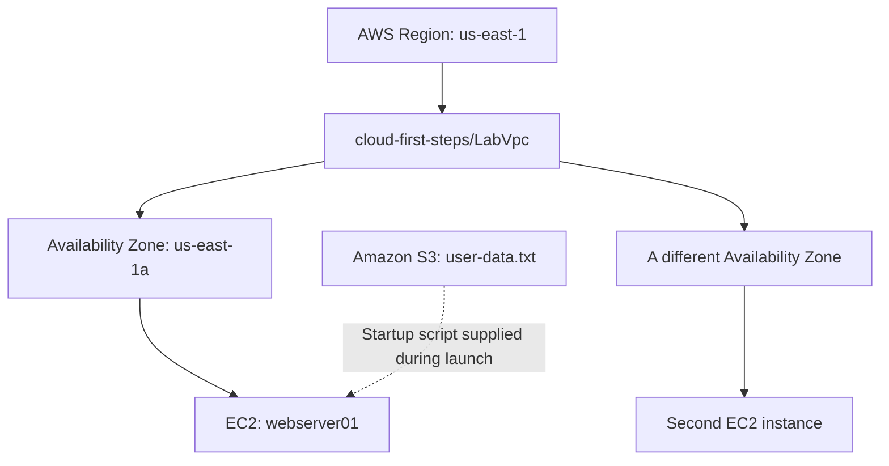

# Deploying Amazon EC2 Instances Across Multiple Availability Zones

**AWS SimuLearn:** Cloud First Steps  
**Project:** 02 — EC2 Cloud Infrastructure  
**Region:** US East (N. Virginia), `us-east-1`  
**Status:** Guided deployment completed; DIY validation passed (learner-reported)

## 1. Business Problem

The island's stabilization system depends on a single physical server with a failing hard drive. Replacement hardware will take two days to arrive, creating an urgent risk of service interruption.

The objective is to explore how Amazon EC2 can provide cloud-based compute capacity and how deploying instances across multiple Availability Zones can reduce dependence on a single infrastructure location.

## 2. Solution Overview

The guided exercise provisions an Amazon EC2 instance running Amazon Linux 2023, with a startup script that installs a web server.

The independent DIY challenge requires deploying a second EC2 instance in another Availability Zone within the same AWS Region.

**DIY result: PASS — learner reported successful AWS SimuLearn validation.**

The validation checked the required instance placement. Automatic application failover was not part of the verified result.

## 3. AWS Services and Components

| Service | Purpose |
|---|---|
| Amazon EC2 | Provision virtual servers |
| Amazon S3 | Store the provided `user-data.txt` script |
| Amazon VPC | Provide the isolated network environment |
| Subnets | Place instances in specific Availability Zones |
| Security groups | Control inbound HTTP traffic |
| Amazon EBS | Provide persistent block storage |
| EC2 user data | Automate initial web-server configuration |

## 4. Architecture

The diagram represents two EC2 instances placed in different Availability Zones. It **does not** depict a configured load balancer, automatic failover, or synchronized application data. The exact second Availability Zone and instance name were not supplied.

## 5. Guided Implementation

### Step 1 — Retrieve the startup script

1. Opened Amazon S3 in `us-east-1`.
2. Selected the bucket beginning with `cloud-first-steps-`.
3. Reviewed the provided `user-data.txt` script.
4. Downloaded the script for use during EC2 provisioning.

The script was supplied by the training environment and described as installing a web server that displays instance information over HTTP port 80. The script contents were not independently provided for inclusion in this repository.

### Step 2 — Configure EC2

| Configuration | Value |
|---|---|
| Instance name | `webserver01` |
| Operating system | Amazon Linux 2023, kernel 6.1 |
| Instance type | `t3.micro` |
| Key pair | Proceed without a key pair |
| VPC | `cloud-first-steps/LabVpc` |
| Subnet | Subnet in `us-east-1a` |
| Security group | `Lab-SG` |
| Security group description | `HTTP Security Group` |
| Inbound rule | HTTP, TCP port 80 |
| Storage | 8 GiB gp3 EBS volume |
| User data | Provided `user-data.txt` |

### Step 3 — Launch and inspect

1. Attached the startup script through **Advanced details → User data**.
2. Launched the EC2 instance.
3. Followed the lab's instructions to inspect its instance state.
4. Located the **Public IPv4 DNS** field.

The learner proceeded to the DIY challenge and reported successful DIY validation. A successful browser-based HTTP response was **not separately recorded**.

## 6. Independent DIY Challenge

**Objective:** Launch a second EC2 instance in a different Availability Zone within the same AWS Region.

The challenge required retaining N. Virginia (`us-east-1`) while placing the two instances in separate Availability Zones.

### Validation result

**PASS — learner-reported AWS SimuLearn validation success.**

The validator checked that two EC2 instances were located in separate Availability Zones. The exact second instance name, Availability Zone, and full configuration were not recorded in the supplied notes.

## 7. Security Considerations

- HTTP port 80 was enabled as required by the training exercise.
- Internet-accessible HTTP traffic is unencrypted; production web applications should generally use HTTPS.
- Security group rules should permit only necessary traffic.
- The guided instance was launched without an SSH key pair, as instructed.
- Production implementations require appropriate access management, patching, logging, and monitoring.

## 8. Reliability Considerations

Deploying instances in separate Availability Zones reduces exposure to failures affecting a single AZ, but it does **not** automatically provide application failover.

A production design might also require:

- An Application Load Balancer and health checks
- An Auto Scaling group
- Application state management
- Data replication or recovery mechanisms
- Monitoring and alerting

**These enhancements were not verified as implemented in this exercise.**

## 9. Troubleshooting Scenarios

The following are potential scenarios, **not incidents confirmed during this lab**.

| Symptom | Investigation |
|---|---|
| Instance stays pending | Review provisioning status, capacity, and account restrictions |
| Website unreachable | Check public address, security group, subnet routing, and web-server startup |
| User data does not configure the server | Inspect cloud-init logs and verify that the script was supplied correctly |
| DIY validation fails | Verify both instances are in `us-east-1` but in distinct Availability Zones |

## 10. Lessons Learned

1. Amazon EC2 enables rapid provisioning of virtual compute infrastructure.
2. Amazon Machine Images provide the operating-system starting point for an instance.
3. EC2 user data supports automated initialization.
4. VPCs and subnets determine network placement.
5. Security groups act as stateful virtual firewalls.
6. EBS gp3 provides persistent block storage.
7. Availability Zones support fault-isolated architecture design.
8. Multi-AZ placement and automatic application failover are different engineering capabilities.

## 11. Interview Questions and Answers

**Q1. What is Amazon EC2?**  
Amazon EC2 is an AWS service that provides configurable virtual compute instances.

**Q2. What is an Availability Zone?**  
An Availability Zone comprises one or more discrete data centers with independent infrastructure inside an AWS Region.

**Q3. Why deploy EC2 instances in different Availability Zones?**  
To reduce the risk that a failure affecting one Availability Zone disrupts all compute resources.

**Q4. What is EC2 user data?**  
Initialization data supplied to an instance, commonly used to run startup scripts and automate configuration.

**Q5. What is the purpose of an EC2 security group?**  
A security group is a stateful virtual firewall controlling permitted inbound and outbound network traffic for associated resources.

**Q6. What is the difference between EBS and S3?**  
Amazon EBS provides block storage commonly attached to EC2 instances. Amazon S3 provides object storage.

**Q7. Does deploying two EC2 instances automatically provide high availability?**  
No. Application health monitoring, traffic distribution, failover behavior, and data handling must also be designed.

## 12. Future Independent Improvements

- Deploy an Application Load Balancer with health checks.
- Configure an Auto Scaling group spanning two Availability Zones.
- Enable HTTPS and CloudWatch monitoring.
- Recreate the infrastructure with infrastructure as code.
- Record browser tests and actual failover behavior.
