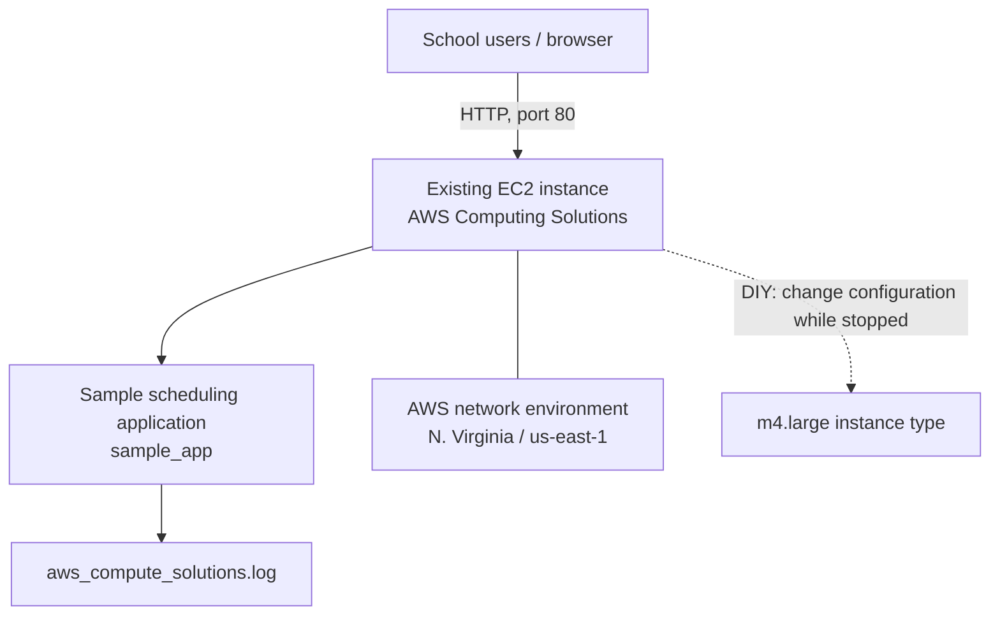

# Amazon EC2 Instance Right-Sizing and Lifecycle Management

**AWS SimuLearn exercise:** Computing Solutions (Project 03)  
**Region:** US East (N. Virginia), `us-east-1`  
**Outcome:** Guided exploration completed; DIY instance-type configuration validation **PASS** (learner-reported)  
**Scope:** Training lab. No production deployment or benchmarked performance improvement claimed.

## 1. Business context and objective

A school's classroom and study-room scheduling application runs on Amazon EC2. The school reported that the application was consuming substantial compute and memory resources, slowing bookings. It anticipated adding online course registration for students.

**Objective:** Explore EC2 compute options, inspect the existing application and its instance configuration, practice instance lifecycle operations, and complete the DIY task of changing the instance type to `m4.large`.

## 2. Architecture and scope



**Important:** The diagram models the lab's existing application and the configuration change. The DIY did **not** include successfully starting an `m4.large` instance, measuring its performance, or proving improved application response time.

## 3. AWS components and concepts

| Component | Role in this exercise |
|---|---|
| Amazon EC2 | Hosts the school's sample application and exposes configurable instance types |
| EC2 instance types | Provide different CPU, memory and performance characteristics |
| EC2 Instance Connect | Provides the lab's browser-based command-line access |
| EC2 user data | Holds startup commands reviewed during the guided exercise |
| Public IPv4 address / DNS | Used to access the sample application over HTTP; may change after stop/start |
| EC2 instance lifecycle | Stop, inspect settings and restart an instance; stop again before changing type |

## 4. Instance-type comparison

The guided lab asked the learner to compare these three types in the **Instance Types** page, including compute, networking, storage and pricing details:

| Instance type | Category | vCPUs | Memory | Consideration |
|---|---|---:|---:|---|
| `t3.large` | Burstable general purpose | 2 | 8 GiB | Good for variable workloads, subject to CPU credit behavior |
| `c5.large` | Compute optimized | 2 | 4 GiB | Relatively CPU-focused |
| `r5.large` | Memory optimized | 2 | 16 GiB | Designed for memory-intensive workloads |
| `m4.large` | General purpose | 2 | 8 GiB | **Required DIY target**; previous-generation instance family |

The lab selected `m4.large` as a prescribed configuration target. This should not be interpreted as proof it is the optimal current production choice. A real sizing recommendation should be based on measured CPU/memory utilization, compatibility, cost, expected peaks and availability.

## 5. Guided implementation

### A. Inspect the existing instance

1. Opened the Amazon EC2 console in `us-east-1`.
2. Selected the instance identified as **AWS Computing Solutions**.
3. Reviewed details of the existing instance.
4. Compared `t3.large`, `c5.large` and `r5.large` in the **Instance Types** view.

**Evidence note:** The original instance type and numeric utilization metrics were not provided in the conversation and are not invented here.

### B. Inspect the web application and logs

1. Copied the instance's public IPv4 address.
2. Accessed the application using `http://<public-ip>` as instructed (not HTTPS).
3. Reviewed SSH client connection instructions and the warning that no SSH key pair was configured.
4. Opened the browser-based EC2 Instance Connect terminal.
5. Ran the following commands:

```bash
cd sample_app
ls
tail -f aws_compute_solutions.log
```

6. Stopped following the log with **Ctrl+C**.

The actual log lines and any resulting diagnostics were not supplied. No specific error or bottleneck is claimed.

### C. Inspect startup automation

1. Opened **Actions → Instance settings → Edit user data**.
2. Reviewed the existing user-data commands.
3. Selected **Cancel** without changing the script.

### D. Practice the EC2 stop/start lifecycle

1. Selected **Instance state → Stop instance**.
2. Waited for **Stopped**.
3. Reviewed the public IPv4 and DNS fields; the lab expected them to become empty.
4. Inspected available instance settings.
5. Selected **Instance state → Start instance**.
6. Waited for **Running** and reviewed the renewed public IPv4/DNS fields.

**Operational caveat:** Stop/start can cause downtime and may change automatically assigned public IPv4 addresses. An associated Elastic IP has different behavior.

## 6. DIY challenge: change instance type

**Specified goal:** Change the existing EC2 instance's instance type to **`m4.large`** in the N. Virginia Region.

**Specified restriction:** The lab **does not grant permission to start the `m4.large` instance**. The task was to change its type configuration only.

### Procedure

1. In EC2, selected **AWS Computing Solutions** in `us-east-1`.
2. Stopped the instance and waited until it was **Stopped**.
3. Opened **Actions → Instance settings → Change instance type**.
4. Selected **`m4.large`** and applied the change.
5. Left the instance **Stopped**, as required by the lab.
6. Submitted the SimuLearn DIY validation.

### Validation results

| Check | Result |
|---|---|
| Target type configured as `m4.large` | **PASS — learner reported successful DIY validation** |
| Instance started as `m4.large` | **Not attempted — explicitly prohibited by lab permissions** |
| Application response time after change | **Not tested** |
| CPU or memory utilization after change | **Not measured** |

The successful validator result establishes the lab's required configuration change, not a performance benchmark.

## 7. Troubleshooting considerations

These are engineering scenarios to consider, **not confirmed incidents** from this exercise:

- **Change instance type is unavailable:** Verify the instance is stopped and selected; confirm compatibility and lab permissions.
- **Browser-based connection fails:** Check instance state, connection requirements, security groups and public network reachability.
- **Application does not respond over HTTP:** Examine the instance status, listening service, routing and inbound traffic rules.
- **Public IP changes after restart:** Update bookmarks or DNS references; use an appropriate stable endpoint for production designs.
- **Performance remains poor despite more resources:** Investigate application code, database latency, I/O, CPU credits, external dependencies and traffic patterns.

## 8. Security, reliability and cost considerations

- The lab used an HTTP endpoint for testing; production applications should assess TLS/HTTPS requirements.
- The SSH key pair warning demonstrated a difference between traditional SSH access and the lab's EC2 Instance Connect browser access.
- Stopping an instance interrupts its application; schedule maintenance or design redundancy in production.
- Changing instance type can alter cost and resource capacity. Review current Region-specific pricing before making real-world recommendations.
- Right-sizing should use measured utilization and service-level objectives, not only a prescribed lab target.

## 9. Key lessons

1. EC2 provides multiple instance families for different workload characteristics.
2. General-purpose, compute-optimized and memory-optimized instances offer distinct trade-offs.
3. Application logs and system metrics answer different troubleshooting questions.
4. EC2 user data is part of repeatable instance initialization.
5. Instance stop/start behavior matters for maintenance and network addressing.
6. Changing an instance type is distinct from running and validating the resized workload.
7. A passing training validator verifies its defined checks, not every production performance claim.

## 10. Interview questions and answers

**Q1. What is EC2 right-sizing?**  
Selecting an instance type and capacity that meet a workload's actual performance needs while avoiding unnecessary resource spend.

**Q2. How do T, C, R and M EC2 families differ?**  
T instances support burstable general-purpose workloads; C is compute optimized; R is memory optimized; M provides a general-purpose balance of resources.

**Q3. Why must you stop an EBS-backed EC2 instance before changing its type?**  
The supported instance-type modification workflow generally requires the instance to be stopped so AWS can change the instance's compute configuration.

**Q4. Does changing an EC2 instance type prove application performance improved?**  
No. Performance must be measured using relevant application and infrastructure metrics after running the workload on the new type.

**Q5. What is the difference between `tail -f` and a CPU utilization metric?**  
`tail -f` streams appended log messages; CPU utilization measures processor consumption. Both can contribute to diagnosis but describe different things.

**Q6. Why might an instance's public IPv4 address change after stop/start?**  
An automatically assigned public address is typically released when the instance stops and a new one assigned at restart, unless a stable addressing mechanism such as an Elastic IP is used.

**Q7. What does EC2 user data do?**  
It supplies startup instructions or configuration data, often used for first-boot setup through cloud-init on Linux AMIs.

**Q8. What is the key distinction between this lab's guided exercise and DIY task?**  
The guided exercise explored instance types, inspected a sample application and practiced lifecycle management. The DIY task specifically changed the configured type to `m4.large` while leaving the instance stopped.

## 11. Screenshots to add (only if actually captured)

- Existing EC2 instance details and original instance type
- Comparison of `t3.large`, `c5.large` and `r5.large`
- EC2 Instance Connect terminal and sample application (without sensitive values)
- Instance stopped before type modification
- Updated instance type showing `m4.large`
- SimuLearn DIY validation success

Redact credentials, account identifiers and other sensitive information. Do not fabricate screenshots or data.

---

**Integrity statement:** This case study describes an AWS SimuLearn guided training exercise and a learner-reported successful DIY validation. The instance was configured as `m4.large` but not started after the change, as required. No production deployment, performance benchmark or independently verified performance improvement is claimed.
