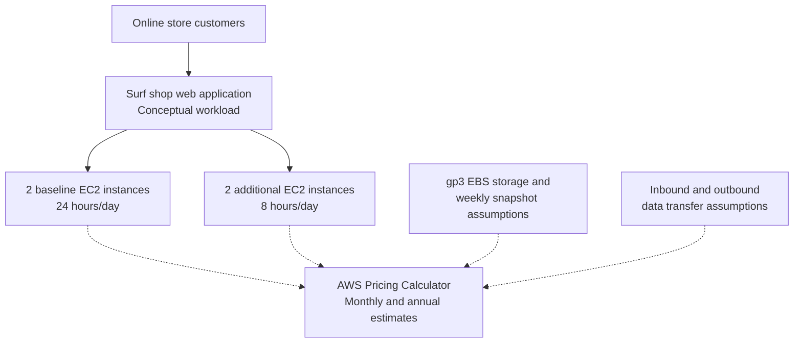

# AWS Cloud Cost Estimation and EC2 Right-Sizing for an Online Store

**Project 04 | AWS SimuLearn — Cloud Economics**  
**Scenario:** Penny Singleton's surf shop e-commerce website  
**Region:** US East (N. Virginia), `us-east-1`  
**Type:** Guided AWS Pricing Calculator exercise + independent DIY challenge  
**Status:** Guided estimate configured; DIY right-sizing validation **PASSED** (learner-reported)

## 1. Business problem

Penny Singleton operates an online surf shop with more website traffic during the day than at night. She is considering moving the online store to AWS and wants to understand expected cloud costs before migration. Rather than run four servers around the clock, her proposed capacity profile uses **two baseline servers** and increases to **four servers during an eight-hour daily peak**.

**Goal:** Build an AWS cost estimate for that daily usage pattern, evaluate compute and supporting infrastructure charges, then complete a right-sizing exercise to compare a smaller EC2 instance choice.

> This is a **pricing estimate**, not a deployment or measured operating-cost report. The lab does not demonstrate that the smaller instance can sustain real production traffic.

## 2. Services and concepts

| Service or concept | Role in this exercise |
|---|---|
| AWS Pricing Calculator | Estimate AWS costs using workload and configuration assumptions |
| Amazon EC2 | Estimate the virtual server capacity for the online store |
| Daily spike traffic workload | Model two always-on servers plus two extra servers for eight hours daily |
| Amazon EBS (gp3) | Include block storage costs |
| EBS snapshots | Include an assumed weekly backup/change pattern |
| Data transfer | Include inbound and outbound network traffic assumptions |
| On-Demand EC2 pricing | Avoid an upfront usage commitment in the estimate |
| Savings Plans / Reserved Instances | Compare alternative purchasing models conceptually; not selected in the guided estimate |

## 3. Workload architecture and cost model

**Diagram scope:** This is a *cost-model illustration*, not an implemented AWS architecture. No load balancer, Auto Scaling configuration, or deployed web application was verified in this exercise.

### Compute utilization calculation

- Baseline capacity: `2 instances × 24 hours = 48 instance-hours/day`
- Additional peak capacity: `(4 − 2) instances × 8 hours = 16 instance-hours/day`
- **Modeled total: 64 instance-hours/day**
- Four always-on instances would consume `4 × 24 = 96 instance-hours/day`.
- The variable-capacity plan reduces modeled instance-hours by `(96 − 64) / 96 = 33.3%` relative to four always-on instances.

This **33.3% is a reduction in modeled compute instance-hours, not total AWS spending**. EBS, snapshot, networking, and other charges remain. Actual spend can also be affected by CPU credit charges and purchasing terms.

## 4. Guided AWS Pricing Calculator estimate

The following settings were prescribed in the SimuLearn guided exercise.

### Estimate organization

| Setting | Value |
|---|---|
| Group | `Web Servers` |
| Service | Amazon EC2 |
| Description | `Web Server Estimate` |
| Location type | Region |
| Region | US East (N. Virginia), `us-east-1` |
| Tenancy | Shared Instances |
| Operating system | Linux |

### Usage and original instance specification

| Setting | Guided value |
|---|---|
| Workload type | Daily spike traffic |
| Days | Sunday through Saturday |
| Baseline | 2 instances |
| Peak | 4 instances |
| Peak duration | 8 hours, 0 minutes |
| vCPUs filter | 2 |
| Memory filter | 4 GiB |
| Network performance | Any |
| Selected instance | **`t3.medium`** |
| Payment option | On-Demand |

### Storage, snapshots, and data transfer

| Component | Lab input |
|---|---|
| Storage for each EC2 instance | General Purpose SSD (`gp3`) |
| IOPS input | `30` as specified in the lab instructions |
| Storage amount | 10 GB |
| Snapshot frequency | Weekly |
| Changed amount per snapshot | 1 GB |
| Inbound transfer | Internet → AWS, 1 TB/month |
| Outbound transfer | AWS → Internet, 100 GB/month |

**Technical note:** Standard gp3 EBS volumes include a baseline provisioned performance of 3,000 IOPS, so the lab's `30`-IOPS entry should not be interpreted as a real gp3 volume performance setting. The value above records the exercise instructions; the actual calculator selection and cost assumptions should be verified against a saved estimate or screenshot.

The guided exercise also involved reviewing Compute Savings Plans, EC2 Instance Savings Plans, Standard Reserved Instances, Convertible Reserved Instances, and support choices. The instructions selected On-Demand pricing and cancelled adding support.

## 5. Guided workflow

1. Opened [AWS Pricing Calculator](https://calculator.aws/) and created an estimate.
2. Created a `Web Servers` group and added Amazon EC2 as `Web Server Estimate`.
3. Selected `us-east-1`, shared tenancy, Linux, and the daily-spike workload profile.
4. Entered two baseline instances, four at peak, with eight peak hours each day.
5. Selected `t3.medium` and On-Demand pricing.
6. Entered EBS, snapshot, and inbound/outbound data-transfer assumptions.
7. Reviewed calculation details, saved the service, viewed the summary, and generated a public estimate link.

The actual monthly and annual dollar amounts were **not supplied in the recorded session**, so they are intentionally not presented as verified results.

## 6. Independent DIY challenge — change to `t2.micro`

**DIY objective:** Edit the EC2 service in the existing price estimate, replace the `t3.medium` choice with **`t2.micro`**, save the changes, and generate a **new** shareable estimate link.

| Attribute | Guided estimate | DIY estimate |
|---|---|---|
| Instance family | T3 | T2 |
| Instance type | `t3.medium` | **`t2.micro`** |
| vCPUs | 2 | 1 |
| Memory | 4 GiB | 1 GiB |
| Region | `us-east-1` | `us-east-1` |
| Payment model | On-Demand | On-Demand |
| Traffic pattern | 2 baseline, 4 peak; 8-hour peak | Retained unless otherwise required |

The smaller instance requires clearing or updating instance filters that would otherwise restrict the list to 2 vCPUs and 4 GiB RAM.

### Validation evidence

**DIY result: PASS — learner reported AWS SimuLearn validation success.**

The stated SimuLearn validation checks whether the instance choice in the estimate was changed to **`t2.micro`**. This confirms the exercise's requested right-sizing configuration, **not** that the new instance size delivers acceptable response times or adequate production memory/CPU capacity.

A new share link was required by the exercise. The final share URL and specific estimated prices were not included in the available notes.

## 7. Estimate result fields to fill from saved calculator output

| Metric | Guided (`t3.medium`) | DIY (`t2.micro`) |
|---|---|---|
| Estimated monthly total | *Not recorded* | *Not recorded* |
| Estimated annual total | *Not recorded* | *Not recorded* |
| Shared estimate URL | *Not provided* | *Not provided* |

> Add actual calculator values and URLs only when retrieved from the saved estimate. Do not infer the savings from instance specifications alone: the final price also depends on storage, transfer, pricing assumptions, and applicable T2/T3 CPU credits.

## 8. Engineering analysis and trade-offs

- **Right-sizing:** `t2.micro` has substantially less memory and vCPU capacity than `t3.medium`. It may lower the estimated compute cost but could be undersized for real e-commerce traffic.
- **Bursty workloads:** Both T2 and T3 families use CPU credit models. Sustained CPU load needs special attention; billing/performance depends on the specific credit settings.
- **Elastic capacity:** Reducing capacity during quiet hours can save compute instance-hours if the application supports scaling safely.
- **Purchasing models:** On-Demand gives flexibility; Savings Plans or Reserved Instances may be worth evaluating for predictable baseline consumption.
- **Cost visibility:** Storage, snapshots, data transfer, monitoring, and support can materially change total cost of ownership.
- **Estimation vs. deployment:** Pricing Calculator models expected charges but does not provision EC2 instances or verify workload performance.

## 9. Troubleshooting and validation checklist

These are **potential issues**, not events claimed to have happened during the lab.

| Symptom | Investigation |
|---|---|
| `t2.micro` does not appear | Clear the 2-vCPU / 4-GiB filters; inspect instance family restrictions |
| DIY validator fails | Confirm the *saved* service uses `t2.micro`, not `t3.medium` |
| Shared link shows old values | Save changes and click **Share** again to generate a fresh link |
| Monthly estimate differs unexpectedly | Review region, hours, purchase option, EBS, snapshots, data transfer, and CPU credit assumptions |
| Estimated savings look attractive but performance is unknown | Test representative application traffic and monitor utilization before production deployment |

## 10. Interview questions and model answers

**Q1. What is AWS Pricing Calculator used for?**  
It creates cost estimates based on selected AWS services, configuration, region, usage patterns, and purchasing assumptions. It is an estimate, not an actual billing statement.

**Q2. Why not run four servers all day?**  
If traffic is predictable and the application can scale, two baseline instances plus two during peak demand use fewer billed compute instance-hours than four always-on instances.

**Q3. How many instance-hours does the configured daily-spike pattern use?**  
`2 × 24 + (4 − 2) × 8 = 64 instance-hours/day`.

**Q4. What does changing `t3.medium` to `t2.micro` accomplish?**  
It changes the estimated compute configuration to a smaller burstable general-purpose instance. It can change the projected compute cost, but application suitability still needs testing.

**Q5. Why include EBS and data transfer in an EC2 estimate?**  
Because compute charges are only one part of the workload's cost. Persistent storage, snapshots, and network egress can add recurring charges.

**Q6. What is the difference between On-Demand and Savings Plans?**  
On-Demand pricing avoids a long-term compute-spend commitment. Savings Plans offer discounted eligible usage in exchange for a one- or three-year commitment.

**Q7. Is a 33.3% reduction in instance-hours the same as a 33.3% reduction in the AWS bill?**  
No. It applies only to modeled compute instance-hours under the stated traffic pattern. Other charges and pricing behaviors affect the total bill.

**Q8. Why generate a new share link after editing an estimate?**  
The updated estimate must be shared explicitly so reviewers and validation tools see the revised configuration rather than an earlier saved version.

