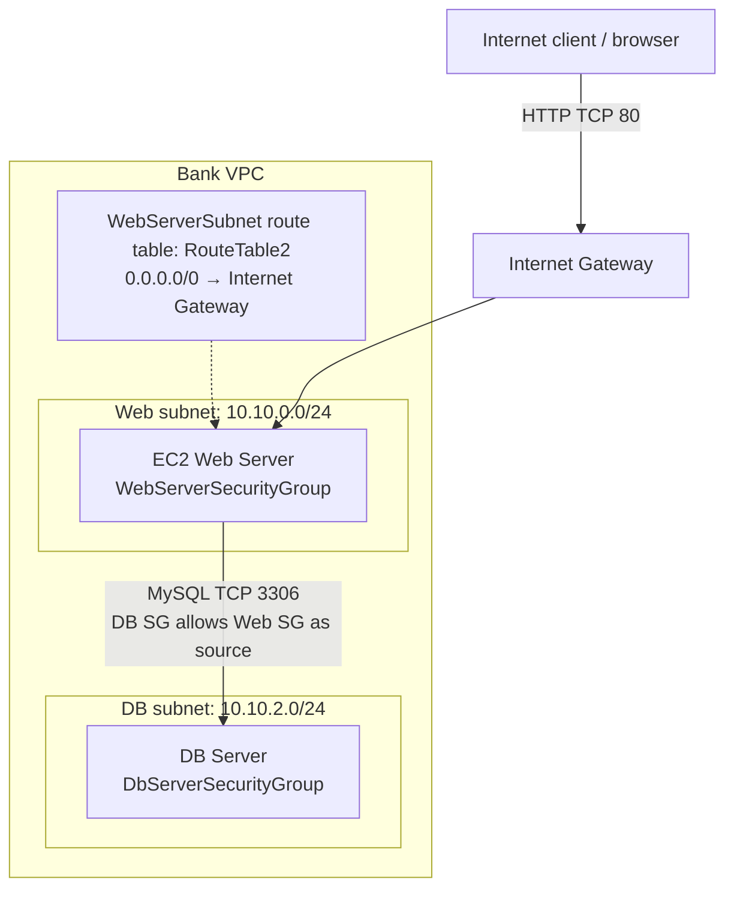

# Troubleshooting AWS VPC Routing and Securing Web-to-Database Connectivity

**AWS Cloud Engineering Portfolio · Project 05**  
**Training:** AWS SimuLearn — Networking Concepts  
**Scenario:** Bank network connectivity troubleshooting  
**Region:** US East (N. Virginia), `us-east-1`  
**Status:** Guided network configuration completed; **DIY validation passed (learner-reported)**

## 1. Business challenge

Pixel Monagher's bank migrated services to AWS, but its application environment experienced two connectivity problems:

1. The public-facing EC2 web server could not be reached from the internet.
2. The web server could not connect to a backend database server.

The goal was to restore required network paths while restricting database access to the application tier rather than exposing MySQL directly to the internet.

## 2. Environment and components

| Component | Role / lab detail |
|---|---|
| Amazon VPC | Virtual network containing the application and database |
| Web Server EC2 instance | Application endpoint in subnet `10.10.0.0/24` |
| DB Server | Database endpoint in subnet `10.10.2.0/24` |
| `WebServerSubnet` | Subnet used by the web server |
| `RouteTable2` | Route table associated with the web server subnet |
| Internet Gateway | Target for the web subnet's `0.0.0.0/0` route |
| NAT Gateway | Initial default-route target removed from `RouteTable2` |
| `WebServerSecurityGroup` | Security group attached to the web tier |
| `DbServerSecurityGroup` | Security group attached to the database tier |
| TCP port `80` | Inbound HTTP access to the web server |
| TCP port `3306` | MySQL/Aurora traffic from web tier to DB tier |

*The provided lab steps did not identify the VPC CIDR, database engine configuration, actual public IP, route-table IDs, or Availability Zones; none are invented here.*

## 3. Architecture



**Architecture note:** This is a simplified traffic and policy diagram for the lab, not a full AWS route-table or subnet-placement specification. The web-to-database traffic travels on the VPC's internal network path; it does **not** use the internet gateway. Actual access also depends on effective routes, network ACLs, instance configuration, and application listeners.

## 4. Investigation and guided remediation

### 4.1 Identify the failed web connection

- Opened EC2 in `us-east-1` and selected **Web Server**.
- Copied the instance's public IPv4 address.
- Tested `http://<public-ip>` in a browser; the guided scenario expected a timeout.
- Inspected the instance's **Networking** tab and followed its subnet link into the VPC console.

### 4.2 Correct the web subnet's internet route

- Selected **WebServerSubnet → Route table → RouteTable2 → Routes**.
- Reviewed the local route and the existing default route pointing to a NAT gateway.
- Used **Edit routes** to remove the NAT gateway default route and create the route below.

| Destination | Target |
|---|---|
| VPC local CIDR | `local` — retained |
| `0.0.0.0/0` | Existing Internet Gateway (`igw-...`) |

This change made the route table suitable for a public subnet, provided the instance had a public IPv4 address and applicable access controls permitted HTTP traffic.

### 4.3 Configure web server security group

The guided lab updated `WebServerSecurityGroup`:

| Direction | Protocol / port | Source or destination | Purpose |
|---|---|---|---|
| Inbound | TCP `80` (HTTP) | `0.0.0.0/0` | Allow public HTTP access for the training web server |
| Outbound | All traffic | `0.0.0.0/0` | Lab-required broad outbound rule |

Existing outbound rules for ports `80`, `443`, and `3306` were also reviewed.

**Security consideration:** Public HTTP and unrestricted outbound access were used because the guided lab instructed them. For a banking production environment, prefer HTTPS, narrowly scoped egress, access logging, and review of all exposed services.

### 4.4 Retest the web application

The guided lab instructed opening the public web server page using **HTTP**, then reviewing a connectivity diagram:

| Connection | Expected after guided steps |
|---|---|
| Internet → Web Server | Connected |
| Web Server → DB Server | Failed (remaining DIY task) |

The scenario's expected diagram states are documented here; no screenshot or independently observed result was supplied.

## 5. DIY challenge — MySQL connectivity

**Goal:** Allow traffic from the web server in subnet `10.10.0.0/24` to the DB server in subnet `10.10.2.0/24` on TCP port `3306`.

The intended change was an **inbound rule on `DbServerSecurityGroup`**, using the web server's **security group as the source**:

| Field | Configuration |
|---|---|
| Target security group | `DbServerSecurityGroup` |
| Rule type | MYSQL/Aurora |
| Protocol | TCP |
| Port | `3306` |
| Source | `WebServerSecurityGroup` (selected by security group ID) |

Referencing `WebServerSecurityGroup` is more tightly scoped than allowing database access from `0.0.0.0/0`. Security group rules permit network traffic; they do not replace database authentication or authorization.

### Validation outcome

**PASS — learner reported AWS SimuLearn DIY validation success.**

Per the lab description, the validator checked whether the web server could reach the database server on port `3306`. The expected diagram state was **Connected**. The actual validator screenshot, packet test results, and rule IDs were not provided.

## 6. Troubleshooting approach

When investigating similar issues:

1. **Confirm scope:** Test public HTTP reachability separately from internal DB reachability.
2. **Check addresses and routing:** Verify public IPv4 on the web server, associated subnet route table, the internet gateway route, and the local VPC route.
3. **Check security groups:** Verify web inbound TCP `80`, permitted egress, and DB inbound TCP `3306` sourced specifically from the web security group.
4. **Check NACLs:** Validate both ingress and egress, including relevant ephemeral return ports, because NACLs are stateless.
5. **Check listeners and application configuration:** Ensure the web service and MySQL endpoint are running and using the expected ports and addresses.
6. **Validate with actual tests:** Record HTTP response, database TCP connectivity, and application-level success where permitted.

## 7. Key security and networking lessons

- An attached internet gateway is not enough; subnet routing and instance addressing also matter.
- A NAT gateway facilitates outbound connections; it does not make private instances directly reachable from the internet.
- A VPC route for local CIDR traffic is distinct from the default internet route.
- Security groups are **stateful**; network ACLs are **stateless**.
- A database can permit access by **source security group** without being publicly exposed.
- Application-to-database connectivity and internet-to-web connectivity are different paths with different policies.
- AWS networking changes should be verified against the actual business requirement, not just assumed correct after saving.

## 8. Interview questions and short answers

**Q1. Why did the web server time out even though it had a public IPv4 address?**  
A public IP alone is insufficient. The subnet must have an appropriate internet gateway route, and security rules and the web service must permit the request.

**Q2. What is the difference between an Internet Gateway and a NAT Gateway?**  
An internet gateway enables public internet routing for eligible VPC resources. A NAT gateway typically lets private resources initiate outbound connections without accepting unsolicited inbound internet connections through that NAT gateway.

**Q3. Why use `WebServerSecurityGroup` as the database rule source?**  
It ties database access to the web tier's security group membership instead of broadly trusting external IP addresses or all internet clients.

**Q4. Does opening TCP `3306` automatically guarantee a working MySQL connection?**  
No. VPC routing, NACLs, service availability, database configuration, and authentication must also work.

**Q5. Why should port `3306` not be opened to `0.0.0.0/0`?**  
It would unnecessarily expand the set of potentially reachable database clients and increase exposure.

**Q6. How are security groups different from network ACLs?**  
Security groups are stateful resource-level controls; NACLs are stateless subnet-level controls, requiring explicit consideration of return traffic.

**Q7. What would improve the production design?**  
Private databases, tightly scoped inbound and outbound rules, HTTPS for external traffic, monitoring, change control, and application/database availability planning.

## 9. Independent extension — Terraform (not implemented in the training lab)

A future Infrastructure-as-Code version can declare the database rule using `aws_vpc_security_group_ingress_rule` and explicitly reference the web server security group:

```hcl
resource "aws_vpc_security_group_ingress_rule" "mysql_from_web" {
  security_group_id            = var.db_security_group_id
  referenced_security_group_id = var.web_security_group_id
  ip_protocol                  = "tcp"
  from_port                    = 3306
  to_port                      = 3306
  description                  = "Allow MySQL only from the web tier"
}
```

**Do not apply this unreviewed to the existing training environment.** Inspect whether the rule already exists and import/reconcile existing infrastructure to avoid duplicate-resource or state conflicts.

## 10. Evidence to add

- Screenshot: `RouteTable2` default route targeting the internet gateway.
- Screenshot: `WebServerSecurityGroup` inbound HTTP and outbound configuration.
- Screenshot: `DbServerSecurityGroup` inbound `MYSQL/Aurora` rule sourced from the web security group.
- Screenshot: connectivity diagram after the fix.
- Screenshot: successful DIY validation.

Do not publish passwords, access keys, sensitive account details, or unredacted private information.

---

**Integrity statement:** This project documents an AWS SimuLearn guided exercise and a learner-reported successful DIY validation. It does not claim production banking infrastructure, independent Terraform deployment, or tests for which evidence was not supplied.
