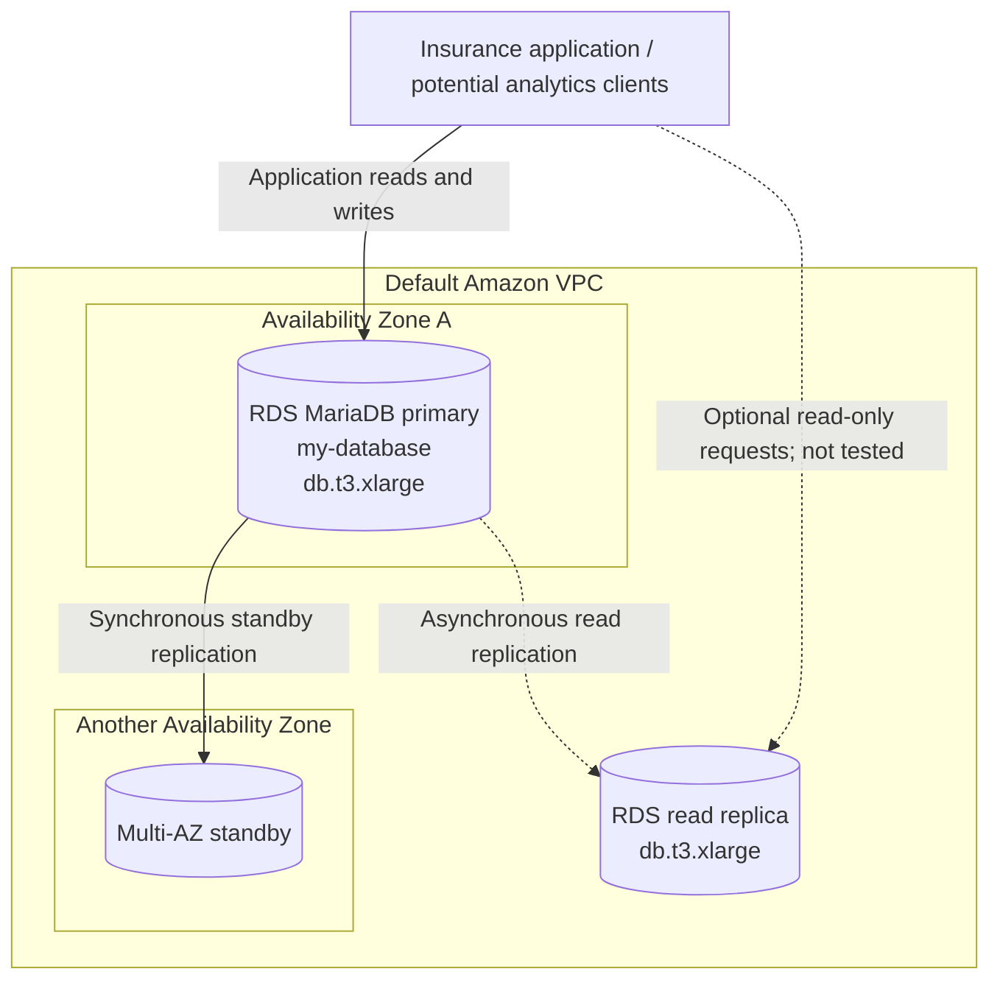

# Deploying Highly Available MariaDB with Amazon RDS and a Read Replica

**AWS SimuLearn:** Databases in Practice  
**Project:** 06 — Managed Databases with Amazon RDS  
**Exercise:** Guided implementation + independent DIY challenge  
**Status:** Guided lab completed; **DIY validation PASS (reported by learner)**

## 1. Business scenario

An insurance company wants its database administrators to spend less time on routine infrastructure management and patching, while improving database availability and supporting read-intensive analytics workloads.

**Goals:**

- Use a managed relational database service to reduce administrative overhead.
- Improve resilience through a Multi-AZ standby deployment.
- Protect data with an appropriate backup strategy.
- Explore read scaling using an RDS read replica.
- Understand how AWS Database Migration Service (DMS) could support a future migration.

## 2. Solution summary

The guided lab created an **Amazon RDS for MariaDB** DB instance with an **additional standby in another Availability Zone**. In the independent DIY task, a **`db.t3.xlarge` read replica** was created from the primary DB instance, `my-database`.

**Outcome:** The learner reported that AWS SimuLearn's DIY validator returned **Success** for the read-replica task.

A Multi-AZ standby and a read replica serve **different purposes**: the standby is for managed failover/high availability; the read replica is for serving read workloads and uses asynchronous replication. No load test, production migration, or actual failover test was recorded.

## 3. Architecture

*Conceptual diagram, not a verified map of physical placement for the replica. The exact replica identifier and Availability Zone were not recorded in the supplied notes.*

## 4. AWS services and design decisions

| Service or feature | Role in the exercise | Engineering significance |
|---|---|---|
| Amazon RDS for MariaDB | Managed relational database | AWS manages much of the underlying infrastructure operations |
| Multi-AZ DB instance deployment | Primary with standby in another AZ | Supports availability and automated failover |
| RDS read replica | Replica of primary | Helps offload compatible read-heavy queries |
| Amazon EBS gp3-backed RDS storage | General-purpose SSD storage | Storage capacity and performance characteristics |
| Storage autoscaling | Can increase allocated storage up to configured maximum | Supports database growth; not compute autoscaling |
| RDS automated backups | Reviewed configuration | Recovery capability subject to configured retention and engine settings |
| AWS DMS | Explored options only | Potential future migration and replication solution |

## 5. Guided implementation — actual supplied lab settings

### 5.1 Explore available database deployment approaches

1. Opened the EC2 **AMI Catalog** and searched for `sql` to review self-managed database images.
2. Located **Aurora and RDS** through AWS service search.
3. Selected **Databases → Create database → Full configuration**.

### 5.2 Create the primary MariaDB database

| Configuration | Lab selection |
|---|---|
| Database engine | MariaDB |
| Engine version | Training environment default; exact version not recorded |
| Template | Dev/Test |
| DB instance identifier | `my-database` |
| Master username | `admin` |
| Credentials management | Self managed (lab-provided password; **not included in portfolio**) |
| DB instance class | `db.t3.xlarge` (burstable class) |
| Storage type | General Purpose SSD (`gp3`) |
| Allocated storage | 20 GiB |
| Storage autoscaling | Enabled |
| Maximum storage threshold | 1,000 GiB |
| Multi-AZ | Create a standby instance |
| VPC | Default VPC |
| DB subnet group | Default |
| Public access | **No** |
| VPC security group | Choose existing |
| Database Insights | Standard |
| Detailed database/per-query metrics | Disabled to comply with lab IAM limitations |
| Enhanced Monitoring | Disabled to comply with lab IAM limitations |
| Initial database name | `my_database` |
| Auto minor version upgrade | Disabled per lab instructions |
| Maintenance window | No preference |

Reviewed default backup, encryption, option group, and parameter group settings. Their precise final values were not recorded and are therefore not asserted here.

### 5.3 Verify the primary database

1. Selected **Create database** and observed the provisioning process.
2. Followed the lab's instructions to refresh the database list until `my-database` reached **Available**.
3. Reviewed the database summary and located the **Actions → Create read replica** option for the upcoming DIY task.

### 5.4 Explore migration options

Opened **AWS Database Migration Service → Getting started** and reviewed:

- **Discover and assess**
- **Migrate or replicate**

**No DMS migration task or database cutover was implemented.**

## 6. Independent DIY challenge — read replica

**Task:** Create an Amazon RDS read replica from the primary instance `my-database`, using a `db.t3.xlarge` DB instance class.

**Validation:** The user reported **Success** from the AWS SimuLearn test server after creating the read replica.

The supplied DIY description refers to the name `my-database-read-replica`, while also stating that any replica identifier may be used. The actual chosen identifier was not supplied; the validated source/replica relationship is the recorded outcome.

**What validation establishes:** The lab accepted the read replica configuration. It does not establish that the learner tested read-routing behavior, measured replica lag, benchmarked throughput, or executed a primary failover.

## 7. Testing and evidence

| Check | Recorded outcome |
|---|---|
| RDS primary configured as MariaDB | Guided exercise completed (learner report) |
| Primary DB identifier | `my-database` |
| Multi-AZ standby selection | Configured in guided exercise |
| Primary reaches Available | Guided exercise completed (learner report) |
| Read replica based on `my-database` | **DIY validator PASS (learner report)** |
| Replica DB class | `db.t3.xlarge` required by DIY |
| Actual failover test | Not performed / not reported |
| Application read performance comparison | Not performed / not reported |
| DMS migration | Not performed |

**Recommended evidence to add from your own lab session:** redacted RDS database list, primary Configuration and Availability/Multi-AZ settings, replica source/class, and DIY validation success screen. Do not publish passwords, connection secrets, or sensitive identifiers.

## 8. Security and operations considerations

- **Private database networking:** Public access was set to **No**. Applications should use private connectivity and narrowly scoped security group permissions.
- **Credentials:** The exercise used a training password. Production deployments should use AWS Secrets Manager or another approved secret-management approach; credentials must not be committed to Git.
- **Backups:** Configure and test retention and restore procedures based on recovery requirements. Multi-AZ is not a substitute for backups.
- **Patch policy:** The lab disabled automatic minor upgrades; production maintenance should use a planned patching process.
- **Read replicas:** Replication may lag, so analytics clients and applications should tolerate potentially stale reads.
- **Costs:** A primary instance, standby capacity, replica, storage, backups, and data transfer can all contribute to total cost. No actual price or benchmark has been measured for this lab.

## 9. Troubleshooting scenarios to investigate (not observed incidents)

| Symptom | Investigation |
|---|---|
| DB stays in Creating/Modifying | Check RDS events, quotas, provisioning status, and permitted configuration |
| Application cannot connect | Verify endpoint, port, VPC routing, security groups, authentication, and private network path |
| Replica creation fails | Check source DB state, engine limitations, privileges, subnet placement, and RDS events |
| Replica lag increases | Assess source write rate, replica resource capacity, long-running queries, and replication metrics |
| Monitoring option causes error | Check IAM permissions; follow restricted lab settings only within that environment |

## 10. Lessons learned

1. Managed databases reduce infrastructure maintenance without removing the need for database administration and application optimization.
2. A traditional RDS Multi-AZ standby is intended for availability and failover, not general read scaling.
3. A read replica can offload supported read workloads but typically replicates asynchronously.
4. Private access, security groups, credentials, and recovery planning remain important even with managed services.
5. A training validator's PASS should be described precisely rather than presented as proof of production resiliency or benchmarked performance.

## 11. Interview questions and answers

**Q1. Why use RDS instead of running MariaDB directly on EC2?**  
RDS automates many infrastructure operations such as provisioning, backups, software maintenance, and availability management, while EC2 self-hosting gives more OS-level control and operational responsibility.

**Q2. How does a traditional RDS Multi-AZ DB instance deployment improve availability?**  
RDS maintains a synchronous standby in another AZ and can initiate automatic failover when supported failure conditions occur.

**Q3. Why doesn't a Multi-AZ standby double database read performance?**  
In the traditional Multi-AZ DB instance model, the standby is not a general-purpose read endpoint for application traffic.

**Q4. How do read replicas help read-heavy workloads?**  
They provide additional read-only endpoints to offload compatible queries from the primary, subject to replication lag and workload requirements.

**Q5. What is the difference between the DB instance identifier and the initial database name?**  
`my-database` identifies the RDS resource; `my_database` is the database schema/database created within the engine during setup.

**Q6. Does a read replica replace backups?**  
No. A replica may reproduce unwanted changes or deletions. Backups and tested restore procedures are still required.

**Q7. What is AWS DMS?**  
A service for supported database migrations and ongoing replication. In this exercise its capabilities were explored, but no migration was executed.

**Q8. What should be checked before moving this design to production?**  
Engine version compatibility, RTO/RPO, restore tests, least-privilege networking, secret management, monitoring, maintenance windows, replica lag, performance benchmarks, and total cost.

## 12. Potential independent extensions (not implemented)

- Provision an RDS test environment using Terraform and secret management.
- Configure CloudWatch alarms for CPU, free storage, and replication lag.
- Connect a test application and measure read workload distribution.
- Perform a supervised restore and failover experiment in a nonproduction account.
- Design a DMS migration with schema conversion and cutover validation where relevant.

---

**Portfolio integrity note:** This project documents a guided AWS SimuLearn exercise and a user-reported successful DIY validation. It does **not** claim an independent production deployment, tested automatic failover, completed migration, or quantified performance improvement.
